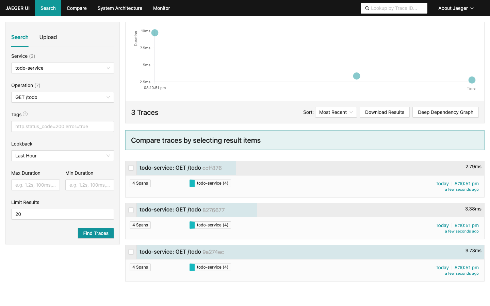
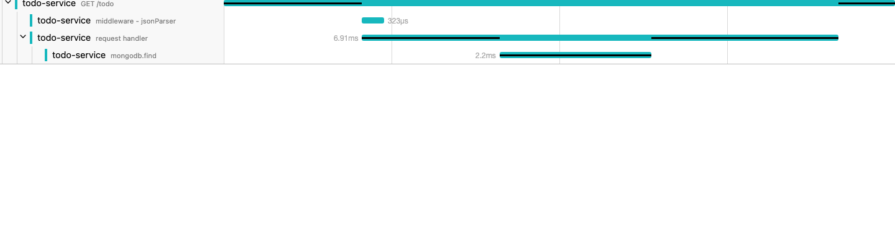
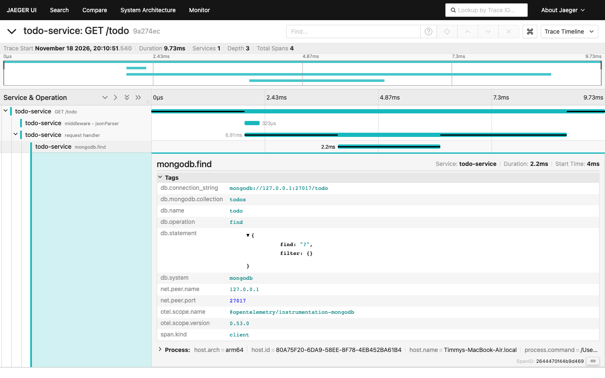

# A9 – Observability with OpenTelemetry + Jaeger

Express + MongoDB "todo" service instrumented with OpenTelemetry (Node SDK). Traces are exported over OTLP/HTTP to a Jaeger all-in-one container; metrics are printed to the console every 10 s.

## Files

- `index.js` – Express server on port 3000. Seeds a `todos` collection in MongoDB and serves `GET /todo` and `GET /todo/:id`.
- `tracing.js` – OpenTelemetry `NodeSDK` setup: `service.name = todo-service`, auto-instrumentations (HTTP, Express, MongoDB, DNS, net), **`OTLPTraceExporter`** to `http://localhost:4318/v1/traces`, and a `ConsoleMetricExporter`.
- `shots/` – Jaeger UI screenshots.

## Run

```bash
docker run -d -p 27017:27017 mongo
docker run -d --name jaeger -p 16686:16686 -p 4317:4317 -p 4318:4318 -p 5778:5778 -p 9411:9411 jaegertracing/jaeger:2.5.0
npm install
node --require ./tracing.js index.js
curl http://localhost:3000/todo
curl http://localhost:3000/todo/2
```

Open http://localhost:16686, pick **todo-service**, and click **Find Traces**.

## Change from the starter `tracing.js`

The provided version used `ConsoleSpanExporter`, which only prints spans to stdout. It now uses `OTLPTraceExporter` from `@opentelemetry/exporter-trace-otlp-http`, so spans are sent to Jaeger's OTLP receiver on port 4318. Set `OTEL_EXPORTER_OTLP_TRACES_ENDPOINT` to override the URL.

`@opentelemetry/resources` and `@opentelemetry/sdk-metrics` are pinned to `~2.0.0` to match the versions that `@opentelemetry/sdk-node@0.200.0` uses internally.

## Screenshots




